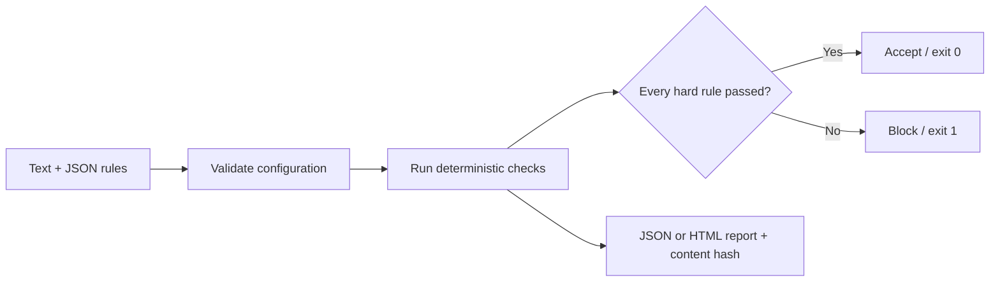

<div align="center">

# Rubric Gate

**Turn text requirements into hard acceptance gates.**

[中文](README.zh-CN.md) · [Quick start](#quick-start) · [Rule reference](docs/rules.md) · [Design](docs/design.md)

[](https://github.com/608tt/rubric-gate/actions/workflows/test.yml)

[](LICENSE)

</div>

Rubric Gate checks documents against a small JSON specification. Preserve names
and dates, require a next step, reject banned phrases, limit length and catch
dangling Markdown footnotes. **A failed hard rule blocks acceptance even when
the weighted score is high.**


## Why it exists

When rewriting text, fluent output can quietly drop a material fact or add an
unsupported promise. Those constraints should be checked separately from style.
Rubric Gate produces an inspectable result for each rule and an exact content
hash, using Python's standard library and no model calls.

- **Seven operators:** all/any required strings, forbidden strings, regex,
  length, footnote consistency and exact SHA-256.
- **Hard versus soft rules:** a veto cannot be averaged away.
- **CI-friendly exits:** `0` accepted, `1` blocked, `2` configuration/input error.
- **Batch reports:** compare multiple documents in JSON or standalone HTML.
- **Reproducible checks:** deterministic results for the same text and rules.
- **Chinese text support:** optional Chinese-character length constraints.

## Quick start

Requires Python 3.10+. No dependencies or API keys are required.

```bash
git clone https://github.com/608tt/rubric-gate.git
cd rubric-gate
python -m rubric_gate examples/passing.md --spec examples/support.json
```

The passing example exits `0`. The blocked example deliberately includes a
forbidden promise and exits `1`:

```bash
python -m rubric_gate examples/blocked.md --spec examples/support.json
python -m rubric_gate examples/passing.md examples/blocked.md \
  --spec examples/support.json --format html --output report.html
```

Open `report.html` to inspect both candidates. All example content is synthetic.
To install the command: `pip install .`, then use `rubric-gate`.

## A minimal specification

```json
{
  "version": 1,
  "rules": [
    {"id": "keep-date", "op": "contains_all", "values": ["2026-10-01"], "hard": true},
    {"id": "no-promise", "op": "excludes", "values": ["guaranteed"], "hard": true},
    {"id": "short", "op": "length", "unit": "words", "min": 20, "max": 100, "hard": false}
  ]
}
```

Rule IDs are unique; `hard` defaults to `true`, and `weight` defaults to `1`.
The score is the percentage of configured rule weights satisfied. It is **not**
a factual-accuracy score or a measure of writing quality.

## Workflow



Use it after a rewrite, in a documentation pipeline or as a pre-review gate.
For model-based evaluation and broader provider integration, see
[promptfoo](https://github.com/promptfoo/promptfoo); Rubric Gate focuses on the
small deterministic layer.

## Tests and scope

```bash
python -m unittest discover -s tests -v
```

11 local tests cover high-score vetoes, soft failures, fact-token changes,
footnotes, bounds, regex/hash checks, invalid specifications, HTML escaping and
exit codes. Local validation used Python 3.14.7; CI targets 3.12/3.13.
See the [validation record](docs/validation.md) for installation checks.

String checks cannot prove the meaning, truth or completeness of a document.
The footnote checker supports basic `[^id]` references and single-line
definitions; it is not a complete Markdown parser. Regex specifications are
trusted local configuration. See [rules](docs/rules.md) and
[limitations](docs/design.md).

Derived from the author's earlier fixed-candidate memorial-writing checks and
generalized for other text workflows. No private memorial corpus or external
project code is included. MIT licensed; [contributions](CONTRIBUTING.md) welcome.
