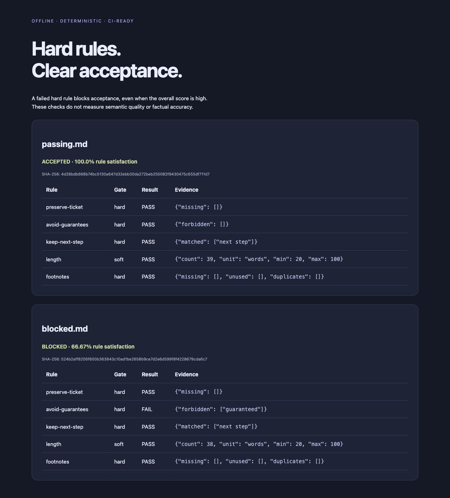

# Rubric Gate · 文本验收工具

**把事实保留和格式要求写成规则，硬性要求失败就阻止验收。**

[English](README.md) · [规则说明](docs/rules.md)



由此前书状候选检查脚本改造成通用工具，可用于文稿改写、客服回复、说明文档等。
只运行确定性检查，不调用模型，无额外运行依赖。

```bash
python -m rubric_gate examples/passing.md --spec examples/support.json
python -m rubric_gate examples/passing.md examples/blocked.md \
  --spec examples/support.json --format html --output report.html
```

需要 Python 3.10+。第二个命令会生成报告，并因为故意不合格的示例返回退出码 `1`。

支持必须全部出现、至少出现其一、不得出现、正则匹配、长度范围、Markdown 脚注配对、
内容哈希七种规则。每条规则可指定硬性或软性要求、分数权重。
总分再高，只要一条硬性规则失败就不能通过。

退出码：`0` 通过、`1` 未通过、`2` 配置或输入错误。
运行 `python -m unittest discover -s tests -v`，当前 11 项本地测试通过。

规则满足率不代表事实正确率，也不能证明法律论证成立。脚注功能检查的是基础文本格式，
不能验证引用内容真实。仓库包含模拟例子，不包含私人书状和比赛材料。MIT 许可。
